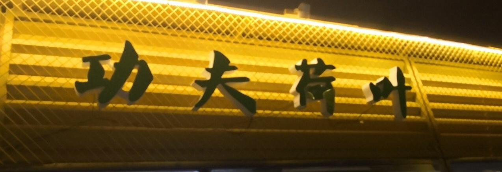

# 中文场景文字识别系统（DBNet + CRNN）

从零训练的中文 OCR 系统：**DBNet 检测** + **CRNN 识别** + Flask 推理服务 + 微信小程序演示。
基于 PaddleOCR 2.7 训练，全部权重为自训练，推理过程不调用任何在线 OCR API。

<p>
  
  
  
  
  
</p>

## 效果示例

| 输入（街景招牌） | 输出（检测框 + 识别结果） |
|---|---|
|  | 检测框坐标 + 文字 + 置信度，由 `/ocr` 接口返回 |

## 模型结构

```
输入图片
   │
   ├─ 检测头 DBNet v3
   │    Backbone: MobileNetV3-Large (scale=0.5, ImageNet 预训练)
   │    Neck:     RSEFPN（残差连接 + SE 通道注意力）
   │    Head:     DBHead（概率图 + 阈值图，可微二值化）
   │    → 输出若干文字区域四边形框
   │
   ├─ 逐框裁剪
   │
   └─ 识别头 CRNN
        Backbone: ResNet34
        Neck:     RNN SequenceEncoder（2 层 LSTM, hidden=256）
        Head:     CTCHead（6625 类 = 6624 字符 + blank）
        → 输出每行文字与置信度
```

## 指标

| 任务 | 配置 | 指标 |
|---|---|---|
| 检测 | DBNet v3（MobileNetV3-L ×0.5 + RSEFPN） | P 0.642 / R 0.671 / **F1 0.656** |
| 识别 | CRNN（ResNet34 + RNN + CTC） | **Val Acc 77.38%** |

完整消融实验（检测 5 组、识别 4 组）与训练曲线见 [docs/benchmarks.md](docs/benchmarks.md)。

## 目录结构

```
.
├── configs/
│   ├── detection/                 # 检测头配置（最终版 + 3 组消融）
│   └── recognition/               # 识别头配置（最终版 + 3 组消融）
├── scripts/
│   ├── setup_env.sh               # 训练环境初始化
│   ├── train_det.sh               # 检测头训练 / 评估
│   └── train_rec.sh               # 识别头训练
├── dataset/
│   ├── det_train_list.txt         # 检测训练标注（图片名 + 四点框 + 文本）
│   ├── det_val_list.txt
│   ├── rec_train_list.txt         # 识别训练标注（图片名 + 文本）
│   ├── rec_val_list.txt
│   └── samples/                   # 少量样例图片
├── inference/
│   └── app.py                     # Flask 推理服务
├── miniprogram/                   # Taro + React 微信小程序（源码）
├── assets/figures/                # 训练曲线与消融对比图
└── docs/benchmarks.md             # 实验记录
```

## 快速开始

### 1. 准备数据与权重

数据集与权重托管在 [Releases](../../releases)：

| 文件 | 内容 | 大小 |
|---|---|---|
| `det_images.zip` | 8000 张街景整图（检测用） | ~735 MB |
| `rec_images.zip` | 43842 张文字条图（识别用） | ~482 MB |
| `det_v3_best.pdparams` | 检测头最终权重 | 3.8 MB |
| `rec_exp_v4_best.pdparams` | 识别头最终权重 | 118 MB |

解压后放成如下结构：

```
dataset/det_images/            # train_sample_000001.jpg ...
dataset/rec_images/            # rec_000001.jpg ...
weights/det_v3_best.pdparams
weights/rec_exp_v4_best.pdparams
```

> 标注文件中的路径为相对路径，需与 `configs/*.yml` 里的 `data_dir` 保持一致。

### 2. 推理服务

```bash
pip install -r requirements.txt

# 推理依赖 PaddleOCR 源码中的 ppocr 模块
git clone -b release/2.7 https://github.com/PaddlePaddle/PaddleOCR.git

python inference/app.py
```

接口：

| 方法 | 路径 | 说明 |
|---|---|---|
| GET | `/health` | 健康检查 |
| GET | `/model_info` | 模型结构与验证指标 |
| POST | `/ocr` | 端到端识别，返回框坐标、文字、置信度、标注图（base64） |

```bash
curl -X POST http://127.0.0.1:5000/ocr -F "image=@dataset/samples/det_sample_01.jpg"
```

### 3. 微信小程序

```bash
cd miniprogram
npm install
npm run dev:weapp
```

用微信开发者工具导入 `miniprogram/dist/`，在「详情 → 本地设置」勾选**不校验合法域名**。
模拟器中的 `localhost` 指向沙箱，需把 `src/services/ocr.ts` 里的 `API_BASE` 改成电脑的局域网 IP。

## 训练

```bash
bash scripts/setup_env.sh

# 检测头（最终版）
bash scripts/train_det.sh

# 识别头（最终版）
bash scripts/train_rec.sh

# 消融实验：传入对应配置即可
bash scripts/train_rec.sh configs/recognition/rec_ablation_baseline.yml
```

训练环境：Ubuntu 22.04 / RTX 4090D 24GB / Python 3.10 / PaddlePaddle 2.6.1 / PaddleOCR release/2.7。
显存占用约：检测 4GB，识别 6GB。

## 关键结论

1. **识别头最有效的改动是输入宽度**：`image_shape` 从 `[3,32,100]` 改为 `[3,32,320]`，长文本截断率由 46.7% 降到 1.8%，验证精度接近翻倍。
2. **Backbone 容量决定上限**：MobileNetV3 训 100 epoch 仍只有 39%，换 ResNet34 后第 6 个 epoch 即 76.6%。
3. **预训练权重必须与字典和结构匹配**：官方 mobile 权重存在 171 处 shape mismatch（等价于随机初始化），改用 Server 63k 中文预训练后首轮验证即 74%。
4. **检测头 Neck 有增益**：RSEFPN 相比默认 DBFPN 提升约 0.008 F1，小目标文字更明显。
5. **数据划分按原图 ID 进行**，避免同一张图裁剪出的文字条同时进入训练集与验证集。

## 踩坑记录

| 现象 | 原因 | 处理 |
|---|---|---|
| 推理权重加载后输出乱码 | `load_model(cfg, model)` 参数顺序写反 | config 在前、model 在后 |
| 识别结果 shape 不匹配 | 配置缺少 `Head.out_channels` | 推理时手动补 6625 |
| 解码报 `unhashable numpy.ndarray` | `CTCLabelDecode` 传了 `lengths` | 不传该参数 |
| 中文标注显示问号 | `cv2.putText` 不支持中文 | 改用 PIL 绘制 |
| 评估指标异常偏低 | 输出目录 `config.yml` 残留其他实验的 resume 路径 | 评估前修正路径 |
| 小程序请求超时 | 模拟器 `localhost` 指向沙箱 | 使用局域网 IP，关闭域名校验 |

## 参考

- [PaddleOCR](https://github.com/PaddlePaddle/PaddleOCR)（release/2.7）
- [DBNet: Real-time Scene Text Detection with Differentiable Binarization](https://arxiv.org/abs/1911.08947)
- [CRNN: An End-to-End Trainable Neural Network for Image-based Sequence Recognition](https://arxiv.org/abs/1507.05717)

## License

[MIT](LICENSE)
