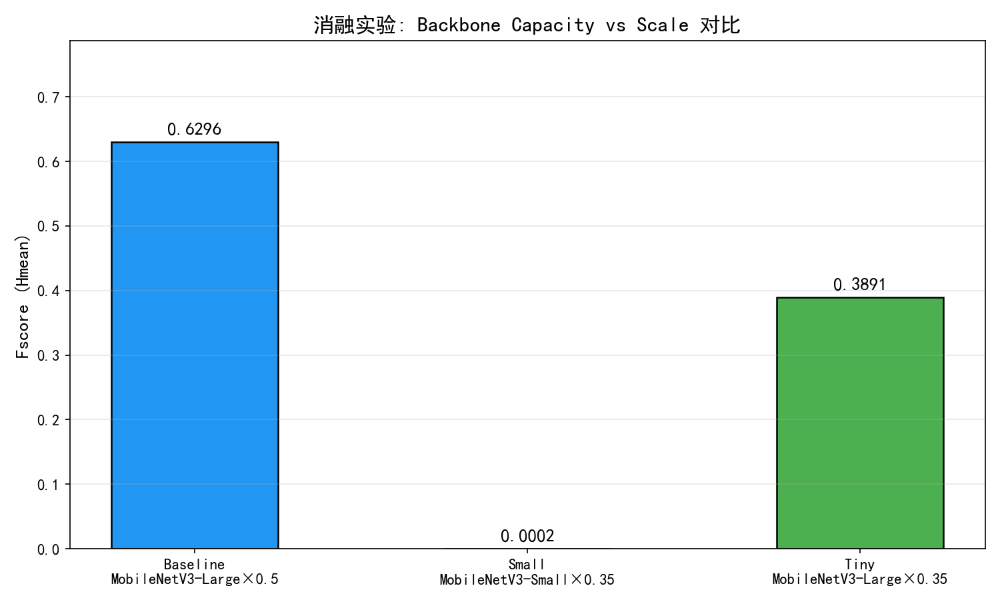
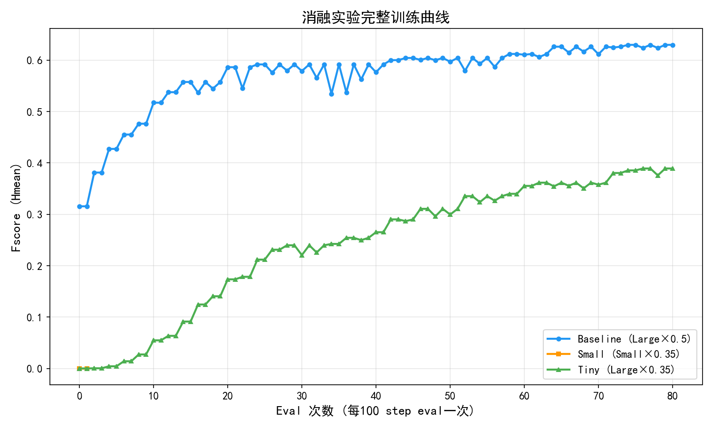
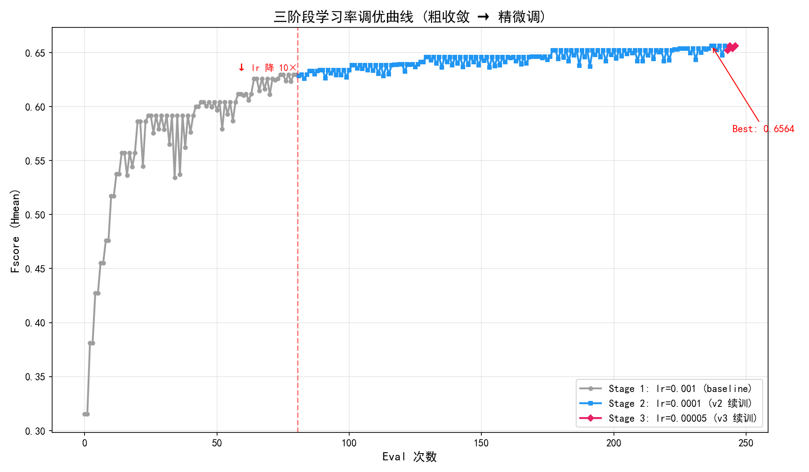
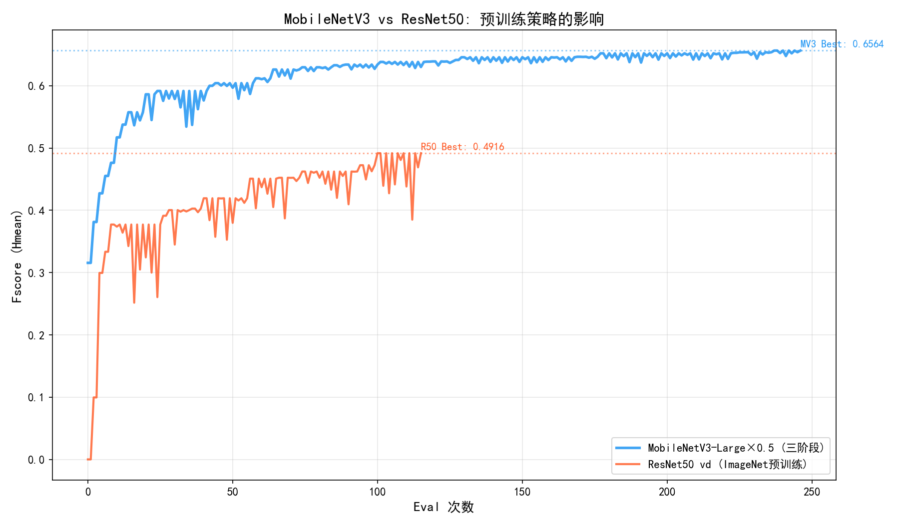
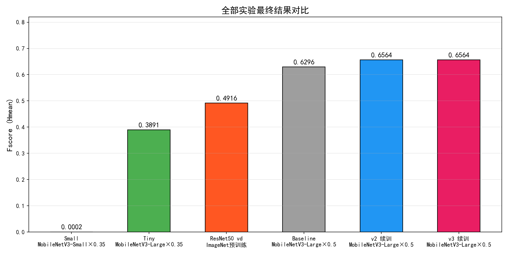

# 实验记录与指标

本项目在 PaddleOCR 2.7 上从零训练两个头：**文本检测头（DBNet）** 与 **文本识别头（CRNN）**。
所有实验均为自训练权重，全程未调用任何在线 OCR API。

## 1. 数据集

| 用途 | 数据源 | 训练集 | 验证集 |
|---|---|---|---|
| 检测头 | 街景招牌整图（8000 张，按原图 ID 8:2 划分） | 6400 张 | 1599 张 |
| 识别头 | 由检测标注框裁出的文字条图（约 43842 张） | 35043 张 | 8740 张 |

> 按原图 ID 划分可避免同一张图的行级裁剪同时出现在训练集与验证集，防止数据泄漏。

## 2. 检测头消融

训练环境：RTX 4090D 24GB，DBNet + ImageNet 预训练，验证集 1599 张。

| 实验 | Backbone | Neck | 其他改动 | Precision | Recall | F-score |
|---|---|---|---|---|---|---|
| Baseline | MobileNetV3-Large × 0.5 | DBFPN | — | 0.6214 | 0.6380 | **0.6296** |
| Tiny | MobileNetV3-Large × 0.35 | DBFPN | 缩小 backbone 宽度 | 0.3938 | 0.3236 | 0.3552 |
| Small | MobileNetV3-Small × 0.35 | DBFPN | 换更小 backbone | 0.3890 | 0.2962 | 0.3363 |
| R50 | ResNet50 | DBFPN | 换重型 backbone | — | — | ≈0.49（26 epoch 后进入平台期） |
| **Final (v3)** | MobileNetV3-Large × 0.5 | **RSEFPN** | 三段式学习率微调 | 0.642 | 0.671 | **0.656** |

结论：

1. **Backbone 容量比宽度缩放更关键**：scale 0.5→0.35 掉 43.6%，换 Small 再掉 5.3%。
2. ResNet50 与 OCR 检测任务域差异大，收敛慢且难以超过轻量配置。
3. Neck 换成 RSEFPN（带残差连接与 SE 通道注意力）后 F-score 提升约 0.008，小目标文字收益更明显。
4. 三段式学习率（0.001 → 0.0001 → 0.00005）在验证集持续创新高时未见过拟合。

## 3. 识别头消融

| 实验 | Backbone | image_shape | 数据增强 | 正则 | Val Acc |
|---|---|---|---|---|---|
| Baseline | MobileNetV3 + CRNN | [3, 32, 100] | 无 | — | 33.8% |
| v2 | MobileNetV3 + CRNN | [3, 32, 100] | RecAug | L2 = 1e-4 | 39.2% |
| v3 | ResNet34 + RNN(256) | [3, 32, 320] | RecAug | L2 = 1e-4 | 76.6% |
| **v4** | ResNet34 + RNN(256) | [3, 32, 320] | RecAug | L2 = 1e-4 | **77.38%** |

结论：

1. **image_shape 宽度是第一影响因素**：[3,32,100] 会截断 46.7% 的长文本，改为 320 后截断率降到 1.8%。
2. ResNet34 的容量对中文识别是必要的，MobileNetV3 训到 100 epoch 仍只有 39%。
3. 预训练权重必须与字典/结构匹配：官方 mobile 权重有 171 处 shape mismatch（等于未加载），改用 Server 63k 中文预训练后首轮验证即 74%。
4. RecAug（RandAugment + Cutout）对小 backbone 抑制过拟合明显，对 ResNet34 影响有限。
5. v4 相比 v3 的收益来自 L2=1e-4，训练/验证精度差距仅 0.12%。

## 4. 端到端

| 指标 | 数值 |
|---|---|
| det F1 | 0.656 |
| rec val Acc | 77.38% |
| 模型体积 | det 3.8MB + rec 118MB |
| 推理设备 | CPU（本地）/ GPU（可选） |

## 5. 训练曲线

